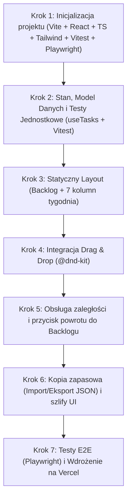

# Stos Technologiczny i Architektura Techniczna (STACK.md)

Dokument zawiera zestawienie wybranych technologii, narzędzi deweloperskich, strategii testowania oraz procedur wdrożeniowych dla projektu **Organizera Pracy (MVP)**, realizowanego na podstawie wymagań z [spec.md](file:///c:/Users/pawel/Desktop/apka/spec.md).

---

## 1. Wybrane Technologie (Tech Stack)

| Narzędzie / Biblioteka | Rola w projekcie | Uzasadnienie wyboru |
| :--- | :--- | :--- |
| **Vite + React** | Środowisko uruchomieniowe i framework UI | Błyskawiczny start i przeładowywanie kodu (HMR), duża elastyczność komponentowa, czytelna struktura dla modeli AI. |
| **TypeScript** | Język programowania | Silne typowanie eliminuje błędy w czasie pisania kodu, gwarantuje spójność modelu danych zadania oraz doskonałe podpowiedzi w edytorze. |
| **Tailwind CSS** | Stylowanie interfejsu | Błyskawiczne prototypowanie bezpośrednio w klasach komponentów bez potrzeby tworzenia rozbudowanych plików CSS. |
| **`@dnd-kit`** | Obsługa Drag & Drop | Nowoczesna, lekka i modułowa biblioteka przeciągania elementów dla Reacta. Zapewnia płynne animacje i pełne wsparcie ekranów dotykowych. |
| **`lucide-react`** | Zestaw ikon | Lekki, spójny wizualnie pakiet ikon wektorowych (kosz, flaga priorytetu, plus, cofanie, import/eksport). |
| **Natywny obiekt `Date`** | Logika dat i czasu | Brak zbędnych zależności zewnętrznych (np. moment.js czy date-fns); wystarczający do wyznaczenia bieżącego dnia tygodnia (`getDay()`). |

---

## 2. Zarządzanie Stanem i Zapis Danych

* **Stan aplikacji:** Dedykowany hook Reacta (`useTasks`) zarządzający listą zadań i operacjami (`addTask`, `updateTask`, `deleteTask`, `moveTask`, `returnToBacklog`).
* **Trwałość danych (Local-First):** Automatyczna synchronizacja stanu w `localStorage` przeglądarki po każdej zmianie.
* **Kopia zapasowa:** Mechanizm zapisu stanu do pliku `.json` (pobieranie przez przeglądarkę) oraz wczytywania pliku `.json` przywracającego stan bazy.

---

## 3. Strategia Testów (Quality Assurance)

### A. Testy Jednostkowe i Integracyjne (**Vitest + React Testing Library + jsdom**)
* **Zakres:**
  * Logika hooka `useTasks`: poprawne dodawanie, modyfikowanie statusu (`done`), zmiana priorytetu oraz usuwanie zadań.
  * Zmiana kolejności i kolumny (`moveTask`) w modelu danych.
  * Prawidłowe wykrywanie dni przeszłych i oznaczanie zadań jako zaległe.
  * Zapis i odczyt z `localStorage` oraz walidacja formatu importowanego pliku JSON.

### B. Testy End-to-End (**Playwright**)
* **Zakres (symulacja prawdziwego użytkownika w przeglądarce):**
  * Wpisanie zadania do Backlogu i zatwierdzenie klawiszem Enter.
  * Fizyczne przeciągnięcie kafelka myszką z kolumny Backlog do kolumny wybranego dnia tygodnia (`@dnd-kit`).
  * Odświeżenie strony (F5) i weryfikacja, czy zadanie pozostało w odpowiedniej kolumnie.
  * Kliknięcie przycisku przywrócenia zaległego zadania z przeszłego dnia z powrotem do Backlogu.

---

## 4. Hosting i Wdrożenie (CI/CD)

* **Platforma:** **Vercel**
* **Konfiguracja:** Budowanie statyczne aplikacji (`npm run build`) publikowane na globalnym CDN Vercel.
* **Cechy:** Automatyczny darmowy certyfikat HTTPS, brak konieczności konfiguracji serwera www, bezproblemowa integracja z repozytorium kodu.

---

## 5. Plan Realizacji (Etapy Techniczne)

1. **Faza 1 – Baza:** Przygotowanie struktury projektu Vite, TypeScript, Tailwind CSS, konfiguracji Vitest oraz Playwright.
2. **Faza 2 – Logika:** Implementacja modelu danych i hooka `useTasks` wraz z pokryciem testami w Vitest.
3. **Faza 3 – Interfejs:** Budowa komponentów widoku (Backlog, kolumny tygodnia, kafelki zadań, podświetlenie bieżącego dnia).
4. **Faza 4 – Przeciąganie:** Wdrożenie sensorów i kontenerów `@dnd-kit` dla płynnego przenoszenia kafelków.
5. **Faza 5 – Zaległości i Kopia:** Wykrywanie przeterminowanych dni, przycisk szybkiego powrotu oraz eksport/import JSON.
6. **Faza 6 – Testy E2E & Wdrożenie:** Testy scenariuszy w Playwright i publikacja na Vercel.
